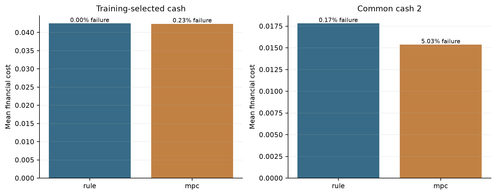

# Solvent but Illiquid: Catastrophe Claims & Dynamic Liquidity Management

**Can a more complex controller justify its use when catastrophe claims fall due before asset sales settle?**

An actuarial research case study of catastrophe-claims liquidity under partial information. A daily cash/asset/settlement engine compares a tuned base-stock rule with receding-horizon linear programming (MPC), using the same observations and resources.

| Held-out experiment | Simple rule | MPC |
| --- | ---: | ---: |
| Payment failures at common cash 2 | 5 / 3,000 | 151 / 3,000 |
| Payment failures at training-selected cash 20 | 0 / 3,000 | 7 / 3,000 |
| Mean financial cost at selected cash | 0.0424905 | 0.0423917 |

Values are per 100 normalised pool units. These are event-conditional simulation frequencies, not measured insurer default probabilities. The simple rule was more reliable. At selected cash, both test upper failure bounds were below the declared 1% appetite; MPC had slightly lower measured cost. This is a reliability/cost tradeoff, not proof of universal policy dominance.

## Start here

- [Project summary](PROJECT_SUMMARY.md): the model, principal results and practical limits.
- [Offline evidence viewer](Offline_Evidence_Viewer_v4.html): download and open locally.
- [Research report](Research_Report_v4.pdf) and [mathematical specification](Mathematical_Specification_v4.md).
- [Model limitations and public-release scope](docs/PUBLIC_RELEASE.md).



## What the engine does

Separates accessible and restricted cash, unsold assets, dated sale receivables, claims arrears, recovery assets and optional secured debt. Independent cash and own-funds identities check each day. Controllers observe current reports and dated receipts, with no access to hidden ultimate loss or future actual payments.

Independent tuning (250), cash-selection (1,000) and test (3,000) cohorts support a common-information comparison. Simultaneous exact training bounds, paired outcome comparisons, deterministic LP benchmarks and out-of-model stresses retain adverse results.

## Verify the public package

Use Python 3.14 and an isolated environment:

```text
python -m venv .venv
# Activate .venv using your platform's normal command.
python -m pip install -r requirements-lock.txt
python verify_public.py
```

This checks the public-file manifest, model tests, 28 frozen path replays, result summaries, cost arithmetic and training selection. The source-free package runs 58 test methods with two primary-source tests explicitly skipped. It does not rerun the full experiment or claim a fresh primary-source audit. Logs go to ignored `work/`.

Third-party PDFs and website snapshots are intentionally absent. For the additional primary-source audit:

```text
python fetch_sources.py --download
python verify_public.py --with-sources
```

Alternatively use `python fetch_sources.py --from-directory PATH_TO_AUTHORISED_ORIGINAL_SOURCES`. All 15 files must match their historical SHA-256 hashes and lengths. Live sites can change: a changed download fails explicitly and is not silently resealed. `sources/` remains ignored. The full audit re-extracts 40 company values and two event-table amounts; other event rows still need manual semantic checking.

To regenerate simulations deliberately, run `python run_study.py`, followed by `extended_validation.py`, `analytic_solver_checks.py`, `exact_benchmark.py`, `failure_diagnostic.py` and `reserve_bridge.py`. This is a substantial compute job and replaces results. It does not refresh the frozen narrative/PDF automatically. After reviewing intentional changes, explicitly author a new inventory with `python release_integrity.py --seal`.

## Evidence boundary

Public issuer disclosures and 11 disaster-payment snapshots across three related-event groups anchor the case. Daily allocation, loss/report uncertainty, execution and recoveries remain synthetic. The cash-20 choice depends on a coarse grid and conservative screening: several lower-cash rule candidates narrowly fail the adjusted training bound. Timing misspecification can materially worsen both policies. This is a liquidity/ALM research pool, not a complete insurer solvency or regulatory-capital model.

[Sources](SOURCE_REGISTER.md) · [Experiment protocol](EXPERIMENT_PROTOCOL.md) · [Publication terms](PUBLICATION_TERMS.md)

Development and documentation used AI assistance. The GitHub Actions workflow has not yet been verified on GitHub.
